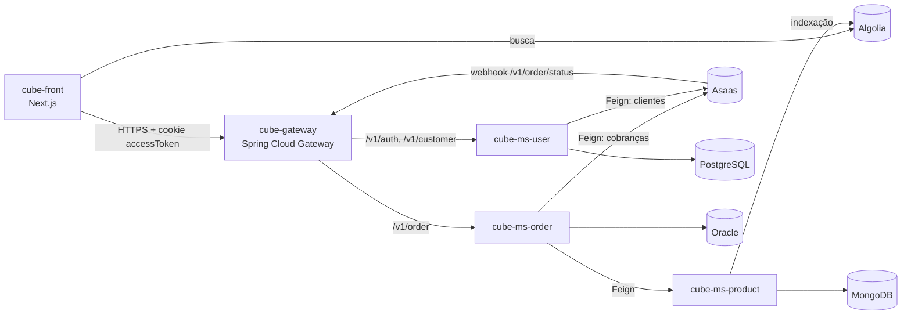

# cube-ms-user

Microsserviço de **usuários e autenticação** do **Cube**. Cuida do cadastro, do login (emissão do JWT), da consulta de dados do cliente e da criação do cliente correspondente no **Asaas**, o gateway de pagamentos.

## Ecossistema Cube



Todos os serviços e o gateway se registram no **cube-ms-eureka**.

| Repositório | Papel | Stack |
| --- | --- | --- |
| [cube-front](https://github.com/MatheysJ/cube-front) | Loja (interface web) | Next.js, Chakra UI, Algolia |
| [cube-gateway](https://github.com/MatheysJ/cube-gateway) | API Gateway e autenticação JWT | Spring Cloud Gateway |
| [cube-ms-eureka](https://github.com/MatheysJ/cube-ms-eureka) | Descoberta de serviços | Netflix Eureka Server |
| **cube-ms-user** (este repositório) | Usuários e login | Spring Boot, PostgreSQL |
| [cube-ms-product](https://github.com/MatheysJ/cube-ms-product) | Catálogo de produtos | Spring Boot, MongoDB, Algolia |
| [cube-ms-order](https://github.com/MatheysJ/cube-ms-order) | Pedidos e pagamentos | Spring Boot, Oracle, Asaas |
| [cube-admin](https://github.com/MatheysJ/cube-admin) | Painel administrativo (em planejamento) | - |

## Funcionalidades

- **Registro**: valida e-mail e CPF/CNPJ únicos, criptografa a senha com BCrypt, cria o cliente no Asaas e salva o usuário no PostgreSQL.
- **Login**: autentica por e-mail e senha, gera um JWT e o devolve no corpo da resposta e em um cookie `accessToken` (`HttpOnly`, `Secure`, expira em 30 minutos).
- **Logout**: expira o cookie `accessToken`.
- **Validação de token** (`/v1/auth/validate`) e **consulta de cliente** (`/v1/customer`, usada pelo front para carregar os dados do usuário logado).
- **CRUD de usuários** (`/v1/user`) com perfis `USER` e `ADMIN`.

A validação do token nas rotas protegidas é feita no [cube-gateway](https://github.com/MatheysJ/cube-gateway).

## Endpoints

### Autenticação — `/v1/auth`

| Método | Rota | Descrição |
| --- | --- | --- |
| `POST` | `/v1/auth/register` | Cadastra um usuário e cria o cliente no Asaas |
| `POST` | `/v1/auth/login` | Autentica e devolve o JWT (corpo e cookie) |
| `POST` | `/v1/auth/logout` | Remove o cookie de acesso |
| `POST` | `/v1/auth/validate` | Valida um token e devolve o usuário (subject) |

Corpo do cadastro (`RequestUser`): `name`, `mail`, `password`, `cpfCnpj`, `phone`. A senha deve ter de 8 a 20 caracteres, com ao menos uma letra minúscula, um número e um caractere especial entre `@ $ ! # % * ? &`.

### Cliente — `/v1/customer`

| Método | Rota | Descrição |
| --- | --- | --- |
| `GET` | `/v1/customer` | Dados públicos do cliente, buscado pelo header `customer_id` (e-mail, injetado pelo gateway) ou `customer_cpfCnpj` |

### Usuários — `/v1/user`

| Método | Rota | Descrição |
| --- | --- | --- |
| `GET` | `/v1/user` | Lista os usuários |
| `GET` | `/v1/user/{id}` | Busca um usuário por id |
| `POST` | `/v1/user` | Cria um usuário (exige o header `x_customer_asaas_id`) |
| `PUT` | `/v1/user/{id}` | Edita um usuário |
| `DELETE` | `/v1/user/{id}` | Remove um usuário |

## Como o token funciona

- Algoritmo **HMAC512** (biblioteca `java-jwt`), com o issuer `cube-ms-user`.
- *Subject*: e-mail do usuário. Claim extra: `asaas_customer_id`.
- O cookie é emitido com `domain=matheus-junior.xyz` e `Secure`, ou seja, ele só é aceito pelo navegador em hosts desse domínio e sob HTTPS.

## Tecnologias

- Java 22
- Spring Boot 3.4.4, Spring Web, Spring Security, Spring Data JPA e Bean Validation
- Spring Cloud 2024.0.1 (OpenFeign para o Asaas, Eureka Client e Config Client)
- PostgreSQL 16 e Flyway
- MapStruct, Lombok e `java-jwt`
- JUnit 5, Mockito e Spring Security Test
- Docker (build multi-stage com Amazon Corretto)

## Variáveis de ambiente

| Variável | Obrigatória | Descrição |
| --- | --- | --- |
| `POSTGRESQL_URL` | Sim | URL JDBC, por exemplo `jdbc:postgresql://localhost:5432/postgres` |
| `POSTGRESQL_USERNAME` | Sim | Usuário do banco |
| `POSTGRESQL_PASSWORD` | Sim | Senha do banco |
| `JWT_SECRET` | Sim | Segredo de assinatura dos tokens. Deve ser igual ao do gateway. |
| `ASAAS_URL` | Sim | URL da API do Asaas (por exemplo, o ambiente sandbox) |
| `ASAAS_API_KEY` | Sim | Chave de API do Asaas |
| `TOKEN_MINUTES_TO_EXPIRE` | Não | Validade do JWT em minutos (há valor padrão) |
| `EUREKA_URL` | Não | URL do Eureka Server |
| `EUREKA_INSTANCE` | Não | Hostname público com que o serviço se registra no Eureka |

## Como executar

Pré-requisitos: JDK 22, Docker (para o PostgreSQL) e um Eureka Server acessível.

1. Suba o PostgreSQL:

   ```bash
   docker compose up -d
   ```

   O `docker-compose.yml` cria um PostgreSQL 16 em `localhost:5432` com credenciais de desenvolvimento definidas no próprio arquivo. Use-as apenas localmente.

2. Defina as variáveis de ambiente e execute:

   ```bash
   export POSTGRESQL_URL="jdbc:postgresql://localhost:5432/postgres"
   export POSTGRESQL_USERNAME="postgres"
   export POSTGRESQL_PASSWORD="<senha do docker-compose.yml>"
   export JWT_SECRET="<segredo compartilhado com o gateway>"
   export ASAAS_URL="https://api-sandbox.asaas.com"
   export ASAAS_API_KEY="<sua chave do Asaas>"
   export EUREKA_URL="http://localhost:8761/eureka/"

   ./mvnw spring-boot:run   # no Windows: mvnw.cmd spring-boot:run
   ```

O serviço sobe em `http://localhost:8080`. As tabelas são criadas automaticamente (`ddl-auto: update`).

### Testes

```bash
./mvnw test
```

A suíte cobre `AuthService`, `UserService` e os controllers de autenticação e de usuário.

### Docker

```bash
docker build -t cube-ms-user .
docker run -p 8080:8080 --env-file .env cube-ms-user
```

## Estrutura

```
src/main/java/com/cube/user
├── controllers/   # Auth, Customer e User
├── services/      # AuthService, TokenService, UserService, CustomerService
├── clients/       # Cliente Feign do Asaas
├── config/        # Spring Security e UserDetailsService
├── models/        # InternalUser (entidade JPA)
├── repositories/
├── mappers/       # MapStruct
├── dtos/          # Request, response e internos
└── exceptions/
```

## Autor

Desenvolvido por [@MatheysJ](https://github.com/MatheysJ).
